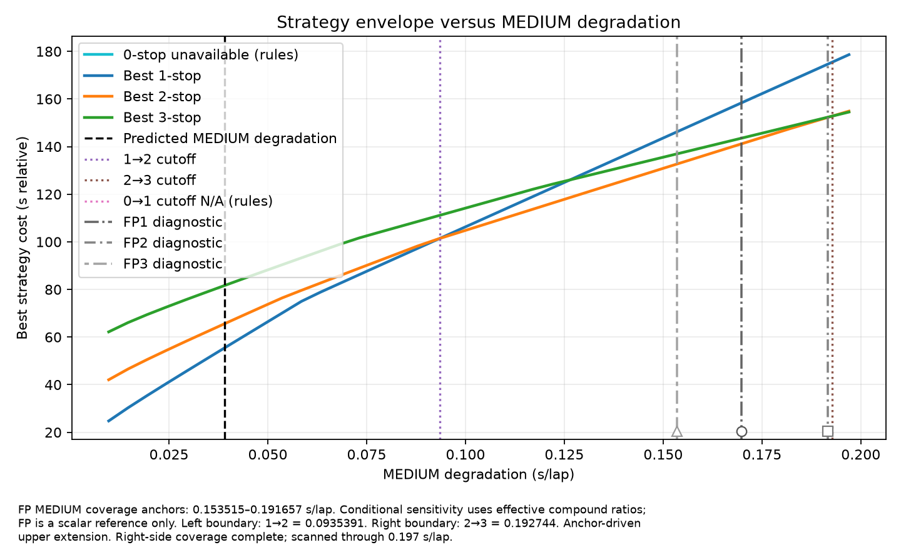
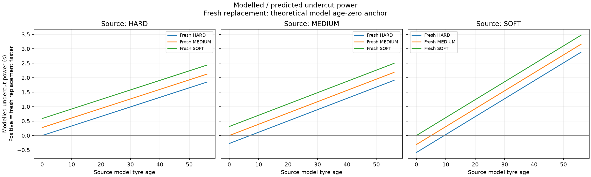
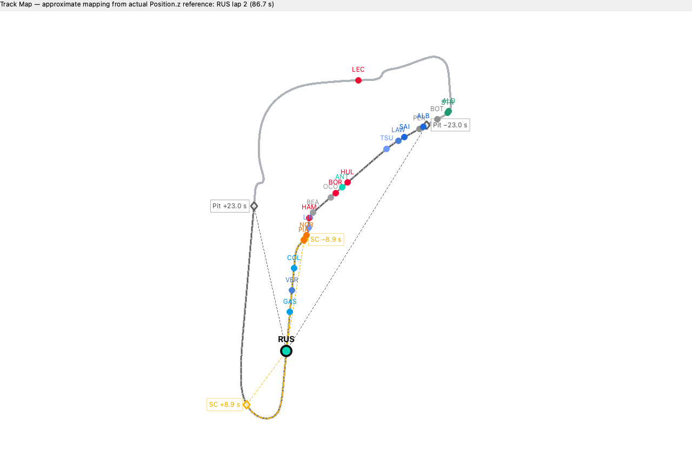
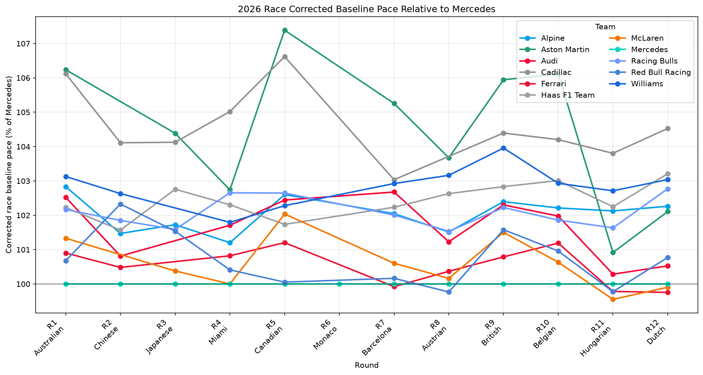

# woStrategy

[dr-wo project home](https://github.com/dr-wo/dr-wo) · [Desktop application](https://github.com/dr-wo/woPlanner) · [Weekend reports](https://github.com/dr-wo/woWeekend)

**The performance, tyre and race-strategy analysis engine of dr-wo.**

`woStrategy` estimates model-relative pace and tyre behaviour from public F1 data,
searches compound sequences and pit timing, and evaluates strategy sensitivity
and retrospective comparisons. This README covers the analytical methods and
examples; the [main project homepage](https://github.com/dr-wo/dr-wo) introduces
the complete five-component ecosystem.

The interface examples below show how [woPlanner](https://github.com/dr-wo/woPlanner)
uses these models. [woData](https://github.com/dr-wo/woData) supplies shared data
contracts, and [woWeekend](https://github.com/dr-wo/woWeekend) coordinates reports.


*woPlanner replay of the 2026 R13 Italian Grand Prix, relative to Russell's
actual pace. This preserved historical capture shows tyre changes, field order
and pit-loss overlays; current controls resolve GREEN, SC and VSC separately.*

[Strategy analysis](#strategy-analysis) · [Race decision support](#race-decision-support) ·
[Performance and methodology](#performance-and-methodology) · [Getting started](#getting-started)

## From race data to a strategy decision

| Stage | What the project does | What the analyst can inspect |
| --- | --- | --- |
| Prepare | Load public timing and telemetry; filter usable laps; combine historical tyre evidence with event descriptors | Data coverage, clean-air support and pre-race compound assumptions |
| Model | Estimate pace and tyre effects with weighted Monte Carlo sampling; keep FP evidence and race inference distinct | Parameter ranges, compound support and model diagnostics |
| Compare | Search compound sequences and pit laps; revalue a fixed plan or optimise its continuation | Ranked alternatives, stop-count crossovers and tyre-only undercut potential |
| Follow | Display timing, track position and pit windows in live/replay views | Traffic context, selected-driver scenarios and model-update history |
| Review | Fit retrospective pace/tyre models and compare strategies against a hypothetical green-race optimum | Team pace, tyre behaviour, assumptions and reproducible report artifacts |

## Strategy analysis

### Which strategy is best under these assumptions?

The deterministic strategy engine searches compound sequences and integer pit
laps using dynamic programming. It can revalue a fixed strategy, optimise pit
timing within the same sequence, or search new continuations from a driver's
completed lap, current compound and physical tyre age. Compound availability,
maximum stops and a minimum number of distinct dry compounds constrain the search.

The Planner exposes ranked sequences, stint bars, global or supported team tyre
models, editable assumptions and pinned comparisons. These are conditional
minimum-cost strategies; the search does not assign a probability of winning.



*Recomputed from the saved 2026 R16 scenario: 56 laps, 23.7 s pit loss and at
least two dry compounds. The 1→2 and 2→3 stop crossovers are approximately
0.0935 and 0.1927 s/lap respectively.*

The sensitivity sweep scales S:M:H degradation together while holding compound
pace deltas fixed. It extends its range when needed to cover usable FP MEDIUM
markers, reports tested boundaries and can evaluate a fourth stop when required.
FP markers remain diagnostics: they do not replace production tyre assumptions
or establish the true optimal stop count. See [cutoff methodology](doc/DEGRADATION_CUTOFF.md).

### How much tyre pace could a stop recover?



*The same R16 tyre model, evaluated through the existing report renderer.
Positive values mean the fresh replacement has a lower modelled lap-time cost.*

Undercut curves reuse the strategy engine's tyre-cost definition for all ordered
compound pairs. The fresh reference is the theoretical age-zero intercept,
not an observed out-lap. This isolates tyre pace; pit loss, warm-up, traffic and
an opponent's response must be considered separately before making a stop decision.

## Race decision support

woPlanner provides completed-race what-if editing and live/replay timing views,
with driver selection, cumulative deltas, tyre markers, range controls and
pit-loss overlays. Recorded messages pass through the shared timing reducers
for repeatable replay. The qualifying monitor adds driver/run state, sectors,
cutoff projections and track-evolution analysis.



*Preserved R13 Track Map capture: selected Russell and surrounding cars, with
GREEN and SC time-window markers. Time offsets are mapped approximately along
an observed reference-lap trajectory; they are not predictions of rejoin order.*

### How do tyre assumptions evolve during a race?


*Preserved R13 replay analysis. MEDIUM is directly informed; HARD becomes direct
when supported; unsupported SOFT remains derived. Line styles distinguish base,
derived and directly informed values.*

The live model consumes committed evidence at causal race-progress cutoffs and
records parameter history. Unsupported compounds retain explicit base or derived
values. Provisional timing displayed in the GUI is kept separate from analytical
inputs, and missing evidence can leave the model unchanged. The historical figure
illustrates that update mechanism, not a guarantee that every current recording
or traffic-filter mode supplies enough usable evidence. On woPlanner main,
automatic Race traffic retains the existing model; new Race fits require explicit
sector-boundary mode and sufficient eligible clean laps.

## Performance and methodology



*Preserved season analysis through R12: inferred team baseline pace relative to
Mercedes after the model's fuel, track and tyre corrections. Event support and
identifiability vary.*

**Race inference.** Clean laps are selected using timing, tyre, track-status and
traffic evidence. Weighted random, Latin-hypercube or Halton candidates explore
fuel proxy, track evolution, compound pace, degradation and team variation.
Corrected driver/team baselines and fit residuals determine candidate weights;
P10/median/P90 summaries retain parameter spread. This is weighted Monte Carlo
sampling, not MCMC, and its spread is conditional on the model and priors.

**Pre-race tyre prediction.** A separate rolling pipeline consumes prior Race
Retro results and processed Pirelli descriptors. It retains historical-baseline
and Pirelli-informed model families, chronological validation and immutable
prediction versions. FP sessions provide a joint weekend fit and diagnostic
evidence; absolute FP degradation remains confounded with fuel/load, and practice
compound performance is not independently identified.

**Post-race evaluation.** Race Retro feeds performance tracking and a
*Retro Green Optimum*: a hypothetical uninterrupted race using retrospective tyre
estimates and a fixed green pit loss. It is a comparison baseline, not a full
SC/VSC-aware reconstruction of the best possible race. Local pairwise pace and
BSF junction references provide additional diagnostics with explicit support and
fallback semantics; the canonical estimator remains primary.

**Operational meaning.** Shared contracts specify units, compound references,
physical tyre age and provenance. The next modelled lap uses completed tyre age
plus one. Effective strategy compound deltas use MEDIUM = 0. Empirical post-race
pit losses remain separate from adopted operational GREEN/SC/VSC assumptions.
Optional prior-venue interruption and traffic summaries provide context without
automatically changing strategy inputs.

All demonstrations use the project's public-data analysis artifacts. The models
support engineering comparison and investigation; they do not have access to
team fuel loads, tyre state or proprietary vehicle models.

## Getting started

Use sibling checkouts and Python 3.10+ for the combined application:

```text
dr-wo/
  woData/
  woStrategy/
  woPlanner/
  woStanding/
  woWeekend/
```

From `woStrategy`, create an environment with Python 3.10+ and install the data
layer and analysis package:

```bash
python3 -m venv .venv
source .venv/bin/activate
python -m pip install -e ../woData
python -m pip install -e .
python -m wostrategy.script.race_performance_review --help
```

For the desktop application, also install and launch woPlanner:

```bash
python -m pip install -e ../woPlanner
woplanner
# Alternative entry points:
woplanner-live
woplanner-quali
```

The analysis package uses FastF1, NumPy, pandas and Matplotlib; the GUI uses
PySide6 and pyqtgraph. `WODATA_ROOT` controls the shared data location. Workflows
reuse supported caches and may acquire missing public session data. Live access
has its own authentication requirements; archived analysis does not require a
live connection.

For a small, offline example using the exact strategy engine and saved R16
inputs, see [the workflow guide](doc/WORKFLOWS.md#offline-strategy-example).
The guide also covers single-event CLI analysis, report orchestration and visual
provenance. [woWeekend's published R13 example](https://github.com/dr-wo/woWeekend/tree/main/examples/2026-R13)
contains preparation and post-race reports with their assumptions and outputs.

## Engineering structure and further reading

The dependency boundary is `woData → woStrategy → woPlanner`; woWeekend
coordinates the packages. Within woStrategy, mathematical models and reusable
algorithms are separated from dataframe analysis, plotting and CLI orchestration.
The analysis engine does not import the GUI.

Tests cover exact-search agreement, rules and tyre-age boundaries, deterministic
sampling, causal model inputs, cache contracts and missing-evidence behaviour.
Reproducible artifacts carry event identity and provenance; reports reference
saved run inputs instead of silently substituting later results.

| Explore | Reference |
| --- | --- |
| Commands, offline example and figure sources | [Workflow guide](doc/WORKFLOWS.md) |
| Race MC, live-retro and identifiability | [Race/FP architecture](doc/RACE_MC_AND_FP_ARCHITECTURE.md) |
| Pre-race prediction and chronological validation | [Cross-event tyre prediction](doc/CROSS_EVENT_TYRE_PREDICTION_V1.md) |
| FP evidence and interpretation limits | [FP tyre estimation](doc/FP_TYRE_ESTIMATION_STATUS_AND_ROADMAP.md) |
| Strategy sensitivity and coverage | [Degradation cutoff analysis](doc/DEGRADATION_CUTOFF.md) |
| Traffic and local pace diagnostics | [Traffic evaluation](doc/traffic_evaluation.md), [local pairwise pace](doc/LOCAL_PAIRWISE_RACE_PERFORMANCE.md) |
| Interactive application | [woPlanner documentation](https://github.com/dr-wo/woPlanner) |

Developed extensively with coding agents. Architecture and investigation notes
preserve assumptions, interfaces and validation decisions across development
sessions. Licensed under [MIT](LICENSE).
