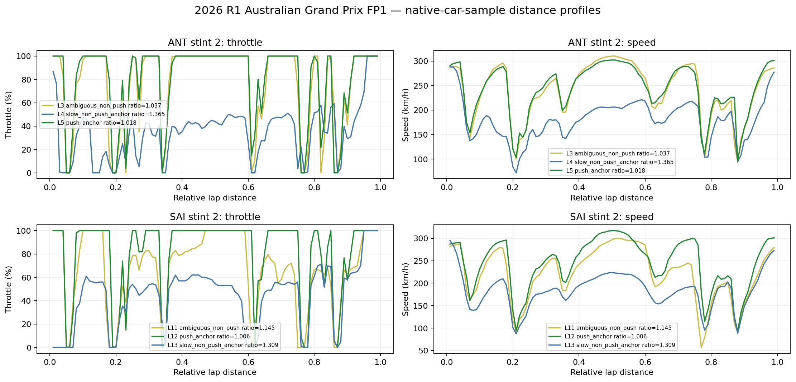
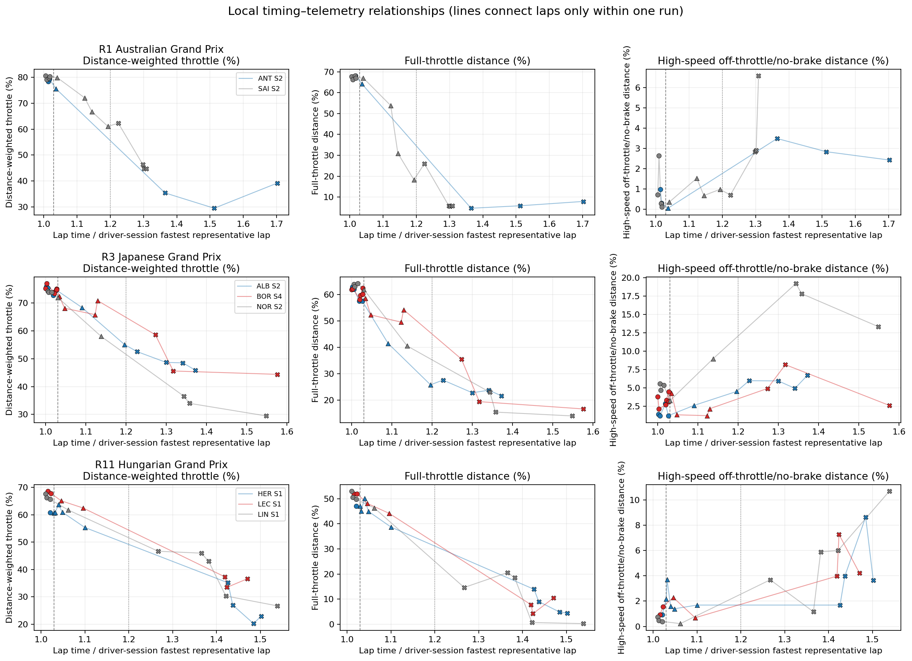
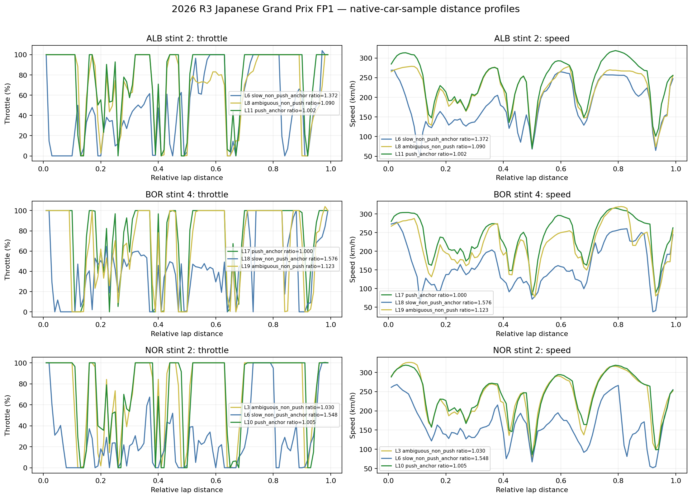
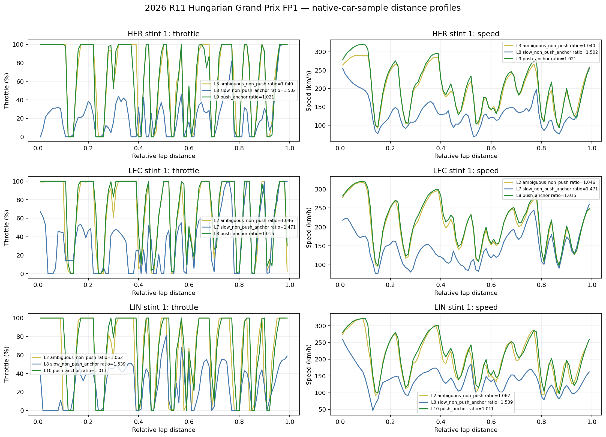

# Telemetry intensity evidence: small offline cross-event validation

Date: 2026-09-20
Scope: 2026 FP1 cached data only; offline R&D; no production or source-cache changes
Status: **closed** (2026-09-21)

## Conclusion

The original Australian result repeats across the Japanese and Hungarian circuits.
In all eight selected continuous runs, push-like timing laps had higher median
distance-weighted throttle, more full-throttle distance and higher spatial mean
speed than the run's very-slow non-push anchors. The slow anchors also had more
high-speed off-throttle/no-brake distance in all eight runs.

Telemetry also repeatedly adds information inside the existing `non_push` timing
bucket. Some laps show distributed, intermediate command/speed profiles; some are
mixtures of push-like and reduced-running sections; and some closely trace the
push reference despite narrowly missing the timing threshold. One Hungarian case
has higher throttle summaries than its run's push median but lower speed, showing
why the channels must not be collapsed into an assumed ordering.

The strongest defensible output is timing context plus separate, interpretable
telemetry summaries and distance profiles for laps compared within one
driver/session/run. Timing-reference choice can explain some timing–telemetry
disagreement, so telemetry is complementary evidence rather than a replacement
classifier. This stage does not validate a universal continuous intensity scale,
a cross-car scale, a normalized intensity score, a relative fuel-burn ratio or
any physical fuel calibration.

## Declared semantics

The report follows the Canonical Pace Contract style without adding a new contract:

- **Observation:** public FastF1 per-sample car telemetry from existing woData
  caches.
- **Filtering role:** dry-compound, timed, green-track, non-pit laps define the
  representative comparison set. Filtering is evidence selection, not a numeric
  intensity transformation.
- **Timing reference:** lap time divided by the driver's fastest representative
  lap anywhere in that FP1 session. This is the unchanged FP classifier reference.
- **Local run reference:** the quickest usable lap inside each selected
  driver/session/stint is recorded separately in `per_lap_results.csv`. Seven of
  eight selected runs do not contain the driver's exact session-fastest lap; their
  local reference pace ratios range from 1.002 to 1.021.
- **Interpretation:** telemetry summaries describe observed driver-command and
  kinematic state only. Comparisons are local to one run.
- **Uncertainty:** coverage, traffic context, reference choice, native sampling
  resolution and cross-run repeatability are reported descriptively. Rows in the
  merged telemetry frame are not treated as independent samples.
- **Explicit exclusion:** no telemetry measure here is fuel flow, engine torque,
  PU/ERS state, or total per-lap fuel consumption.

## Sample selection fixed before additional telemetry inspection

The sample rule was:

1. Use existing 2026 FP1 lap and telemetry caches for R1 Australia, R3 Japan and
   R11 Hungary. The latter two provide high-speed and high-downforce circuit
   contrast to the initial event.
2. Reproduce Australia SAI stint 2 and ANT stint 2 as mandatory checks.
3. Using lap timing metadata only, form driver/stint runs from representative
   dry, green, non-pit laps. Retain candidates with at least four representative
   laps, at least one existing push-like lap (`pace ratio <= 1.03`) and at least
   one descriptive slow anchor (`pace ratio >= 1.20`).
4. For each new event, rank candidates by number of timing bands, then band
   transitions, representative-lap count, driver and stint; take the first three.
5. Keep every representative lap in each selected run. Telemetry values, traffic
   values and visual attractiveness do not affect selection.

The `1.20` boundary is only a fixed descriptive slow anchor for this report. It is
not a production cool-lap threshold. Laps between `1.03` and `1.20` remain
`non_push` and are called `ambiguous_non_push`; they are not forced into a
semi-push class.

| Event | Run | Team / compound | Representative laps | Selection |
|---|---|---|---:|---|
| Australia FP1 | ANT stint 2 | Mercedes / MEDIUM | 6 | Required reproduction |
| Australia FP1 | SAI stint 2 | Williams / HARD | 12 | Required reproduction |
| Japan FP1 | BOR stint 4 | Audi / SOFT | 13 | Timing-only rank 1 |
| Japan FP1 | ALB stint 2 | Williams / HARD | 10 | Timing-only rank 2 |
| Japan FP1 | NOR stint 2 | McLaren / MEDIUM | 8 | Timing-only rank 3 |
| Hungary FP1 | HER stint 1 | Cadillac / HARD | 10 | Timing-only rank 1 |
| Hungary FP1 | LIN stint 1 | Racing Bulls / MEDIUM | 9 | Timing-only rank 2 |
| Hungary FP1 | LEC stint 1 | Ferrari / MEDIUM | 7 | Timing-only rank 3 |

The machine-readable selection and source hashes are in `selected_runs.csv` and
`source_manifest.csv`.

## Metric definitions

All lap summaries use accepted forward distance increments from 0 to 50 metres;
negative, missing or larger increments are excluded. A channel value is assigned
to the increment ending at that merged telemetry row, matching the initial
diagnosis.

- **Distance-weighted throttle:** throttle averaged using accepted distance
  increments.
- **Full-throttle distance:** accepted distance with throttle at least 95%, divided
  by total accepted distance.
- **High-speed off-throttle/no-brake distance:** accepted distance with speed at
  least 150 km/h, throttle at most 5% and the binary brake channel false, divided
  by total accepted distance. This is a limited lift/coast-related observation,
  not proof of a lift-and-coast technique.
- **Supporting diagnostics:** distance-weighted speed and RPM, brake distance and
  distance in gears 7 or higher.
- **Distance profiles:** throttle and speed are interpolated to a 1%-lap-distance
  grid using only native `Source == "car"` rows. Position/interpolation rows do not
  become additional observations.

Lap duration remains in the per-lap table. No metric is obtained by summing rows
or normalizing a chosen push lap to a physical `1.0`.

## Coverage and exclusions

- Selected runs contained 91 physical lap rows. Seventy-five representative laps
  were included and all 75 had usable telemetry.
- Sixteen exclusions were retained in `lap_coverage_and_exclusions.csv`: seven
  out-laps, six in-laps, two missing-time in-laps and one out-lap under track
  status 671.
- Included lap duration ranged from 80.287 to 146.155 seconds.
- Merged-channel row coverage was 100% on every included lap. Accepted-distance
  coverage ranged from 93.4% to 100.0%, with a 99.0% median.
- Native car-channel cadence ranged from 3.57 to 4.17 Hz, median 4.17 Hz. Merged
  frame density ranged from 7.07 to 8.33 Hz, median 7.69 Hz. The latter is not
  independent car-channel evidence.
- DRS was identically zero for every included lap and is uninformative here.
- Nine of 75 included laps had mean estimated gap ahead below three seconds. They
  were deliberately retained rather than silently cleaned away; traffic may
  contribute to their timing/telemetry disagreement. No included lap had mean gap
  behind below one second.

## Initial-example reproduction

Values reproduce the earlier diagnosis. The only apparent discrepancy is ANT lap
3's off-throttle value: 0.040% here was previously displayed as 0.0% after
one-decimal rounding.

| Run/lap | Existing timing label | Pace ratio | Weighted throttle | Full-throttle distance | High-speed off-throttle distance | Spatial mean speed |
|---|---|---:|---:|---:|---:|---:|
| ANT S2 L3 | non-push | 1.037 | 75.6% | 64.2% | 0.040% | 240.6 km/h |
| ANT S2 L4 | non-push slow anchor | 1.365 | 35.4% | 4.7% | 3.5% | 180.9 km/h |
| ANT S2 L5 | push-like | 1.018 | 79.3% | 68.0% | 0.3% | 244.4 km/h |
| SAI S2 L11 | ambiguous non-push | 1.145 | 66.8% | 31.0% | 0.7% | 221.6 km/h |
| SAI S2 L12 | push-like | 1.006 | 80.5% | 67.6% | 0.7% | 244.4 km/h |
| SAI S2 L13 | non-push slow anchor | 1.309 | 44.8% | 5.8% | 6.6% | 185.4 km/h |



## Cross-event recurrence

The table compares per-run medians. Positive values mean the direct channel
contrast has the expected direction; these are not combined into a score.

| Event/run | Push − slow weighted throttle | Push − slow full-throttle distance | Slow − push off-throttle distance | Push − slow spatial speed |
|---|---:|---:|---:|---:|
| Australia ANT S2 | +43.4 pp | +62.0 pp | +2.2 pp | +66.1 km/h |
| Australia SAI S2 | +34.4 pp | +61.5 pp | +2.4 pp | +56.4 km/h |
| Japan ALB S2 | +26.4 pp | +36.6 pp | +4.7 pp | +51.2 km/h |
| Japan BOR S4 | +29.3 pp | +41.7 pp | +1.7 pp | +45.2 km/h |
| Japan NOR S2 | +39.9 pp | +48.6 pp | +12.5 pp | +59.4 km/h |
| Hungary HER S1 | +35.8 pp | +40.1 pp | +2.9 pp | +60.1 km/h |
| Hungary LEC S1 | +31.6 pp | +44.2 pp | +3.0 pp | +64.4 km/h |
| Hungary LIN S1 | +23.3 pp | +35.9 pp | +5.4 pp | +53.2 km/h |

Thus the broad push-versus-very-slow separation repeats in all eight runs and all
three events. The sample was selected for timing diversity, so this is conditional
repeatability evidence—not an estimate of prevalence, classifier accuracy or
statistical independence from lap time. Speed is especially coupled to lap time;
the independent addition is primarily the repeated difference in throttle-command
patterns and their location around the lap.







## Ambiguous, mixed and contradictory cases

There were 21 `ambiguous_non_push` laps. In 17, distance-weighted throttle,
full-throttle distance and spatial mean speed all lay between that run's push and
slow-anchor medians. This is descriptive only: the sample ranking favored runs
with all timing bands, and the three channels are not independent.

The profiles show that the same average can arise in different ways:

- **Distributed intermediate evidence:** Australia SAI L11 is lower than L12 over
  multiple acceleration/straight sections while retaining the same track-position
  structure. It is not merely one isolated slow corner.
- **Section mixture:** Japan ALB L8 and BOR L19 remain push-like in some zones but
  reduce throttle and speed substantially in others. Their lap averages should not
  be interpreted as uniform intermediate operation.
- **Near-push timing disagreement:** Australia ANT L3, Japan NOR L3, Hungary LEC L2
  and LIN L2 trace their run's push profile closely despite being timing non-push.
  ANT L3, for example, is only 3.2 throttle points, 3.7 full-throttle-distance
  points and 3.0 km/h below its run's push medians.
- **Channel contradiction:** Hungary HER L3 (`pace ratio 1.040`) has weighted
  throttle 63.7% and full-throttle distance 50.1%, both above the only push
  anchor's 60.7% and 47.0%, but speed is 196.5 versus 202.8 km/h. Its mean gap
  ahead is 2.59 seconds, so traffic is one plausible contributor; execution,
  tyres and unobserved car/PU state remain alternatives.
- **RPM is supporting, not decisive:** push-minus-slow median RPM ranged from only
  76 rpm in ALB's run to 1,879 rpm in HER's. Australia SAI differed by only 101
  rpm despite large throttle and speed separation.

Per-channel positions and deltas for every ambiguous lap are retained in
`ambiguous_lap_comparisons.csv`. No combined state label is emitted.

## What telemetry adds, and what remains unsupported

Telemetry adds repeatable evidence that the timing classifier's broad `non_push`
bucket contains several physically different observed states: clear reduced
running, distributed partial running, section mixtures and nearly push-like laps
with time loss elsewhere. Distance profiles make those differences visible beyond
one lap-average number.

The evidence does not identify why a lap differs. Traffic, tyre state, car setup,
driver execution, absolute car performance and unobserved PU/ERS or aero behaviour
remain confounded. The zero-valued DRS channel cannot resolve aero availability.
Throttle is a command, brake is binary, and RPM/gear/speed do not reveal torque or
fuel flow. A longer low-load-looking lap can still not be converted into relative
total per-lap fuel consumption.

## Recommendation

Close this R&D stage with the existing offline outputs: timing context plus the
separate, reference-declared channel summaries and distance profiles used here.
The supporting observations are consistent push-versus-strongly-reduced-running
separation in 8/8 runs across three circuits, recurring intermediate and
mixed-section profiles, and timing–telemetry disagreements that timing alone
cannot describe.

Do not proceed from this evidence to a weighted proxy, universal normalized
intensity score, relative fuel-burn ratio or physical fuel model. Push–Cool
Sequence work may later consume these diagnostics as auxiliary evidence, but this
R&D neither specifies nor implements that integration.

## Execution and change check

- Report generation completed successfully from the six existing input-cache
  files and produced 75/75 usable representative-lap rows.
- Focused and adjacent checks passed: `38 passed` across
  `test_telemetry_intensity_validation.py`,
  `test_clean_lap_track_development.py` and `test_telemetry_loader.py`.
- The new calculation checks cover spatial rather than row-weighted aggregation,
  fixed timing-band boundaries, native cadence reporting and exclusion of
  interpolated position rows from distance-profile construction.
- Python compilation of the new script and test completed without errors.
- R&D calculation code is limited to the isolated report generator and its focused
  test. Report artifacts are confined to `doc/telemetry_intensity_validation/`;
  the only existing tracked-file update made when closing the stage is the short
  README R&D-index entry. No production classifier, configuration, contract or
  woData source cache is modified.
- The generated artifact directory is approximately 3 MB.

## Reproduction

From the `woStrategy` repository, with the existing sibling `woData` caches:

```bash
MPLBACKEND=Agg \
MPLCONFIGDIR=/private/tmp/mpl-telemetry-validation \
PYTHONPATH=src:../woData/src \
.venv/bin/python -m wostrategy.script.telemetry_intensity_validation \
  --output-dir doc/telemetry_intensity_validation

PYTHONPATH=src:../woData/src \
.venv/bin/pytest -q tests/test_telemetry_intensity_validation.py
```

The generator fails if a required cache is missing; it never downloads or refreshes
source data. Generated CSVs include selected runs, per-lap results, exclusions,
per-band summaries, run contrasts, ambiguous-lap comparisons, profile data and
source hashes.
